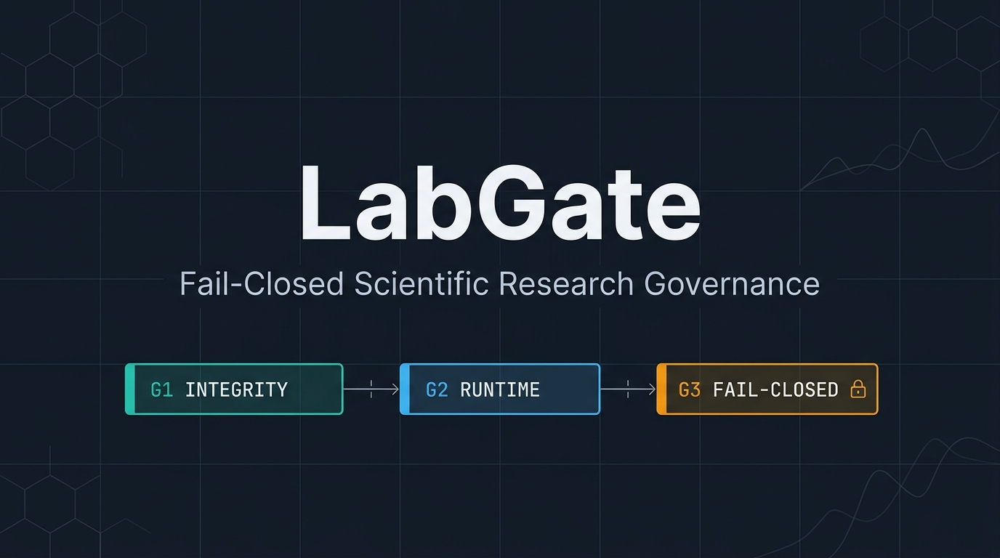
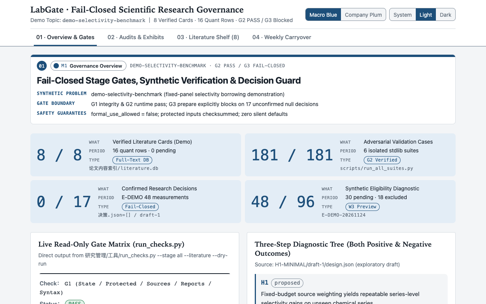
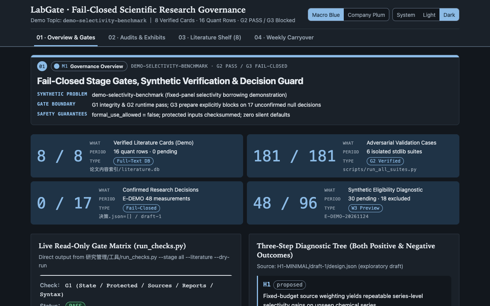
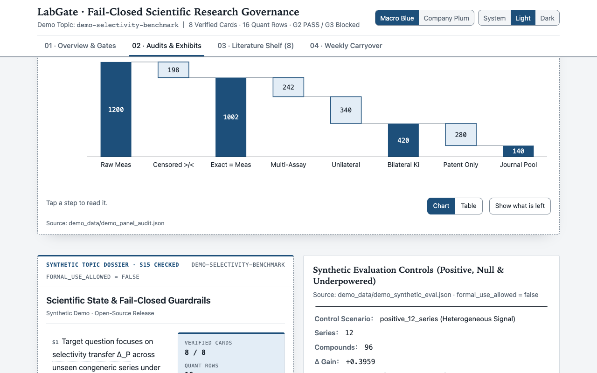
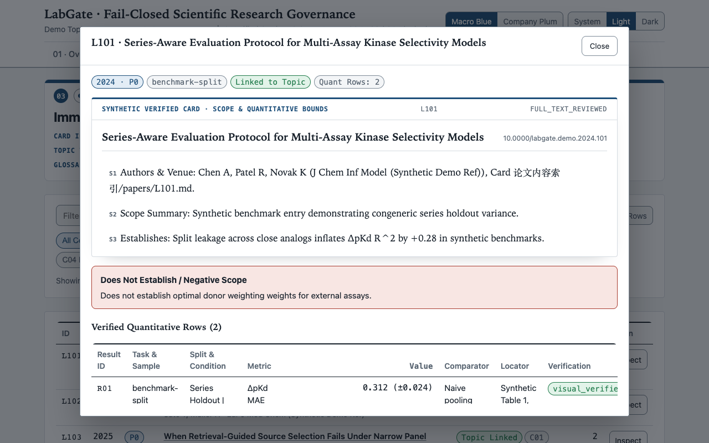

<div align="center">



# LabGate

**Fail-Closed Research Governance for AI-Driven Science & Experimental ML**

[](https://www.python.org/)
[](scripts/run_all_suites.py)
[](研究管理/工具/)
[](研究管理/看板/build_dashboard.py)
[](LICENSE)

[English](README.md) · [简体中文](README_ZH.md) · [CLI Manual (ZH)](研究管理/README.md) · [Interactive Dashboard Builder](研究管理/看板/build_dashboard.py)

</div>

---

## Why LabGate?

Machine learning research—especially in AI for drug discovery, bioinformatics, and empirical benchmarks—rarely fails from lack of models. It fails silently when unconfirmed hypotheses slip into training runs, held-out test splits are accidentally touched multiple times, censored assay inequalities get imputed as point values, or literature claims drift from underlying experimental scope.

**LabGate** is a **zero-dependency, pure Python 3.12 standard-library research governance engine** built on one strict rule:

> **Fail-Closed by Default.** Any missing scientific decision, unverified confirmation signature, tampered upstream artifact, leaked credential, or unbacked evaluation split hard-blocks downstream execution—with machine-readable JSON diagnostics and zero silent fallbacks.

---

## Architecture

```mermaid
flowchart LR
    subgraph G1["G1 · Structural & Epistemic Integrity"]
        S1["Source Registry\n(SHA-256 + Headers)"]
        S2["S15 Topic Dossiers\n(9 Sections + Decisions)"]
        S3["Literature Lineage\n(Read-Only SQLite URI)"]
        S4["Weekly Carryover\n(Parent-Locked JSON)"]
    end

    subgraph G2["G2 · Engineering & Transactional Runtime"]
        R1["Immutable Run Logger\n(W9 Bundle Chain)"]
        R2["Transactional Sync\n(W11 Lock + Recovery)"]
        R3["Split Validator\n(W7 Series Isolation)"]
    end

    subgraph G3["G3 · Fail-Closed Admission Lock"]
        F1["17 Required Decisions\n(Explicit null Guard)"]
        F2["W10b Protocol Freeze\n(Closure Hashing)"]
        F3["Cross-Version Test\nExposure Journal"]
    end

    G1 --> G2 --> G3
    G1 -.-> Dash["Offline HTML Dashboard\n(@zhouyang/rtr-ui-kit)"]
    G2 -.-> Dash
    G3 -.-> Dash
```



| Subsystem | Standard-Library Entrypoint | What It Enforces | Verified Suite |
| --- | --- | --- | --- |
| **Unified Gate Runner** | [`run_checks.py`](研究管理/工具/run_checks.py) / [`check_all.py`](研究管理/工具/check_all.py) | Orchestrates G1, G2, G3 (`prepare`/`result`), workbench freshness, and literature DB health cleanly with `--dry-run`. | `runtime` / `links` |
| **Protocol Freeze & Exposure** | [`freeze_protocol.py`](研究管理/工具/freeze_protocol.py) · [`credential_scan.py`](研究管理/工具/credential_scan.py) | Freezes protocol drafts with upstream byte closure, logs cross-version `final_test` accesses, and blocks secret/signed-URL leaks without echoing secrets. | [`verify_freeze.py`](研究管理/测试/verify_freeze.py) (`44/44`) |
| **Literature Lineage (`S15`)** | [`literature_index.py`](研究管理/工具/literature_index.py) · [`evidence.py`](研究管理/工具/evidence.py) | Opens `literature.db` strictly via `?mode=ro&immutable=1`, verifies card SHA-256 & negative-claim boundaries, and rejects unconfirmed prose claims. | [`verify_links_and_checks.py`](研究管理/测试/verify_links_and_checks.py) (`32/32`) |
| **Series-Aware Split Checker** | [`check_split.py`](研究管理/工具/check_split.py) | Validates zero-leakage scaffold/series holdouts, donor pool isolation, and per-fold pairing without permitting formal use. | [`verify_split.py`](研究管理/测试/verify_split.py) (`30/30`) |
| **Run Ledger & Recovery** | [`run_logger.py`](研究管理/工具/run_logger.py) · [`sync_runs.py`](研究管理/工具/sync_runs.py) | Records immutable portable run bundles, catches duplicate/orphan revisions, and recovers crashed lock transactions deterministically. | [`verify_runtime.py`](研究管理/工具/verify_runtime.py) (`18/18`) |
| **Topic Isolation & Workbench** | [`topics.py`](研究管理/工具/topics.py) · [`research.py`](研究管理/工具/research.py) | Enforces topic isolation, prevents cross-topic confirmation reuse, and publishes `工作台.md` deterministically. | [`verify_desk.py`](研究管理/测试/verify_desk.py) (`33/33`) |
| **Weekly Carryover Ledger** | [`make_report.py`](研究管理/工具/make_report.py) | Locks previous week's plan via parent SHA-256, reconciles every unfinished item, enforces 4 feasibility guards, and blocks jargon leakage. | [`verify_report.py`](研究管理/测试/verify_report.py) (`24/24`) |
| **Offline HTML Dashboard** | [`build_dashboard.py`](研究管理/看板/build_dashboard.py) | Compiles live gates, interactive SVG/table/waterfall exhibits, SQLite literature cards, and weekly reports into one self-contained HTML file. | `build_dashboard.py --check` |

---

## Interactive Offline Dashboard

Built with vendored [`@zhouyang/rtr-ui-kit`](研究管理/看板/vendor/rtr-ui-kit/NOTICE.md) and zero build tools (`build_dashboard.py` emits a single `232 KB` standalone HTML file with light/dark theming, keyboard-accessible tabs, responsive tables, and native `<dialog>` modals).

<table>
  <tr>
    <td width="50%">
      
      <p align="center"><b>Overview & Stage Gates (Light)</b> — Real-time G1/G2/G3 matrix, 181/181 suite status, and 17 strict null decision guards.</p>
    </td>
    <td width="50%">
      
      <p align="center"><b>Overview & Stage Gates (Dark)</b> — Automatic semantic token switching with tabular numeric alignment.</p>
    </td>
  </tr>
  <tr>
    <td width="50%">
      
      <p align="center"><b>Audits & Exhibits</b> — Dual-scale bar-line & arithmetic-checked waterfall SVG charts, synthetic evaluation controls, and inline glossary popovers.</p>
    </td>
    <td width="50%">
      
      <p align="center"><b>Literature Shelf & Quant Modal</b> — Filterable read-only SQLite catalog opening native <code>&lt;dialog closedby="any"&gt;</code> cards with negative-claim callouts.</p>
    </td>
  </tr>
</table>

---

## 60-Second Quickstart

Requires only **Python 3.12+** (zero `pip install`, zero `npm install`):

```bash
git clone https://github.com/hongyuanzhou453/labgate.git
cd labgate

# 1. Run all 6 adversarial test suites (181 cases) + G2/G3 + dashboard + hygiene checks
python3 -B scripts/run_all_suites.py

# 2. Verify engineering gate G2 passes cleanly against the committed synthetic baseline
python3 -B 研究管理/工具/run_checks.py --stage G2 \
  --runtime-report 研究管理/_交付/demo-baseline/runtime-final/report.json --literature

# 3. Observe fail-closed G3 blocking cleanly on 17 unconfirmed null decisions
python3 -B 研究管理/工具/check_all.py --stage G3 --phase prepare \
  --problem demo-selectivity-benchmark --dry-run

# 4. Rebuild the single-file offline dashboard and open it in any browser
python3 -B 研究管理/看板/build_dashboard.py --refresh
open 研究管理/派生/看板/科研看板.html   # Linux: xdg-open
```

To re-seed a clean synthetic demonstration workspace from scratch:

```bash
python3 -B scripts/seed_demo_workspace.py && python3 -B 研究管理/看板/build_dashboard.py --refresh
```

---

## Validation Matrix (181 / 181 Passing)

Every rule in LabGate is backed by positive and adversarial negative test cases executed in isolated temporary workspaces (`--dry-run` verified to leave zero artifacts or lock files behind):

| Suite | Cases | Key Adversarial Checks Verified |
| --- | :---: | --- |
| `verify_runtime.py` | **18** | Byte tampering detection, concurrency lock serialization, crash recovery, NaN/duplicate JSON rejection, credential exclusion |
| `verify_links_and_checks.py` | **32** | Missing/corrupted SQLite boundary (`unavailable` vs zero), cross-topic card contamination, `dec=0` vs `false` distinction, process child exit propagation |
| `verify_freeze.py` | **44** | Upstream byte drift post-freeze, cross-version `final_test` exposure tracing, secret/signed-URL blocking without secret echo |
| `verify_desk.py` | **33** | Case-insensitive topic collision guard, cross-topic table isolation, source hash drift detection |
| `verify_split.py` | **30** | Cross-role/donor compound leakage detection, fold isolation checks, `formal_use_allowed = false` invariant |
| `verify_report.py` | **24** | Tampered `last_week_plan` override rejection, silent unfinished-item drop rejection, external fallback enforcement, prose jargon linter |
| **Total** | **181** | Verified continuously on every push via [GitHub Actions CI](.github/workflows/ci.yml) |

---

## Adapting LabGate to Your Own Research Project

1. Declare your read-only upstream ledgers, comparison tables, and audit files inside [`研究管理/来源映射.json`](研究管理/来源映射.json).
2. Capture a portable baseline snapshot (`snapshot.py`) and register your topics via `research.py new <topic-id>`.
3. Customize [`研究管理/看板/build_dashboard.py`](研究管理/看板/build_dashboard.py) sections cleanly without modifying anything under `研究管理/工具/`, keeping your runtime code-hash verification intact.

## License

Released under the [MIT License](LICENSE). Vendored offline browser UI components in `研究管理/看板/vendor/rtr-ui-kit/` are accompanied by [`NOTICE.md`](研究管理/看板/vendor/rtr-ui-kit/NOTICE.md).
