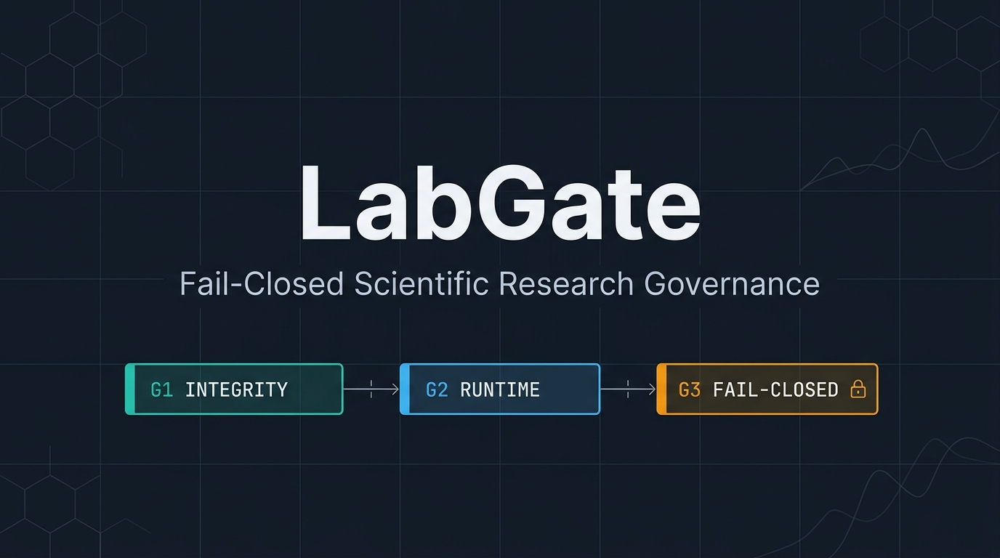
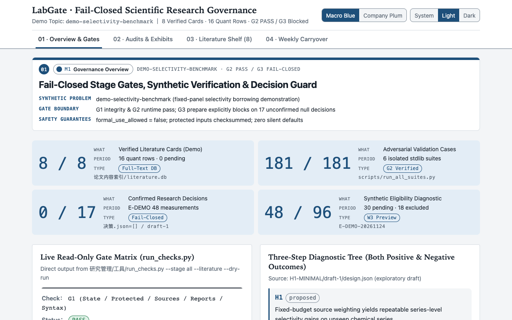
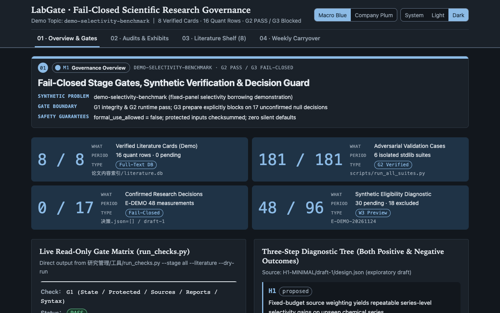
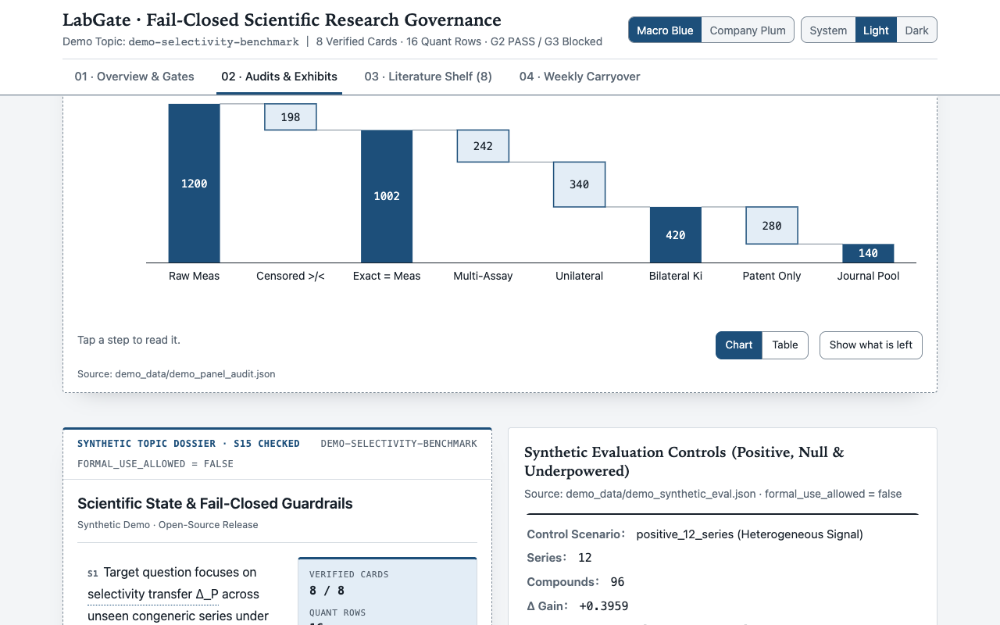
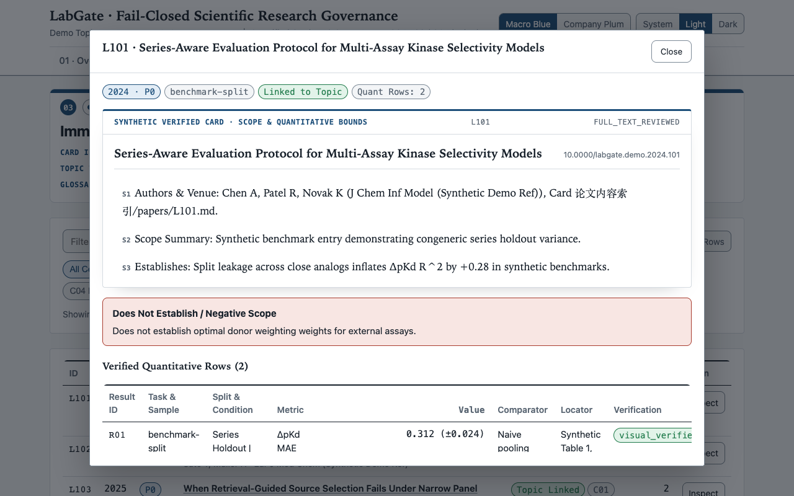

<div align="center">



# LabGate

**面向 AI 辅助科研与实验型机器学习的「默认闭门」治理引擎**

[](https://www.python.org/)
[](scripts/run_all_suites.py)
[](研究管理/工具/)
[](研究管理/看板/build_dashboard.py)
[](LICENSE)

[English](README.md) · **简体中文** · [详细 CLI 操作手册](研究管理/README.md) · [离线看板生成器](研究管理/看板/build_dashboard.py)

</div>

---

## 为什么做 LabGate？

AI 驱动科研（药物发现、生物信息学、实证 ML 评测）很少死在“模型架构不够新”，而往往死于隐性工程与统计失效：**测试集在无意中被提前偷看、未定案的实验阈值在跑完结果后才被事后补填、删失测量不等式被静默插补成精确点值、周报与文献原文悄悄脱节**。

**LabGate** 是一套**零第三方依赖、纯 Python 3.12 标准库实现**的科研治理与防泄漏基础设施，全部设计围绕一条硬原则展开：

> **默认闭门（Fail-Closed by Default）。** 只要缺少关键科研确认原件、测试集存在未预登记的跨版本暴露、上游数据字节漂移、运行包夹带凭据，或任意前置门禁尚未满足，系统一律**显式拒绝放行**，输出精确机器可读 JSON 诊断，绝不静默跳过或代填默认决定。

---

## 核心架构与子系统

| 子系统 | 核心入口 | 强制执行的不变量 | 验收覆盖 |
| --- | --- | --- | --- |
| **三级门禁总控 (`G1/G2/G3`)** | [`run_checks.py`](研究管理/工具/run_checks.py) · [`check_all.py`](研究管理/工具/check_all.py) | 统一调度结构门 `G1`、工程门 `G2` 与科研准备/结果门 `G3`，全部只读子命令默认强制 `--dry-run`。 | 全仓总入口 |
| **协议冻结与测试暴露 (`W10b`)** | [`freeze_protocol.py`](研究管理/工具/freeze_protocol.py) · [`credential_scan.py`](研究管理/工具/credential_scan.py) | 按题锁定协议与上游全部输入字节闭包；跨协议版本追查 `final_test` 访问记录；静态拦截凭据与签名 URL（报错不回显密钥）。 | [`verify_freeze.py`](研究管理/测试/verify_freeze.py) (`44/44`) |
| **只读文献双向联查 (`S15`)** | [`literature_index.py`](研究管理/工具/literature_index.py) · [`evidence.py`](研究管理/工具/evidence.py) | 以 `?mode=ro&immutable=1` 打开 `literature.db`（零 WAL/SHM 旁文件），校验主卡哈希与“能说明/不能说明”边界，禁止未登记肯定决定散落正文。 | [`verify_links_and_checks.py`](研究管理/测试/verify_links_and_checks.py) (`32/32`) |
| **防泄漏划分验算 (`W7`)** | [`check_split.py`](研究管理/工具/check_split.py) | 校验同系物系列留出、供体池隔离与折内配对规则；永远将 `formal_use_allowed` 锁为 `false` 直到真实审批落地。 | [`verify_split.py`](研究管理/测试/verify_split.py) (`30/30`) |
| **不可变运行登记与崩溃恢复 (`W9/W11`)** | [`run_logger.py`](研究管理/工具/run_logger.py) · [`sync_runs.py`](研究管理/工具/sync_runs.py) | 不可变运行包修订链、同版本并发冲突拦截与断电锁恢复重建。 | [`verify_runtime.py`](研究管理/工具/verify_runtime.py) (`18/18`) |
| **课题隔离与工作台 (`desk`)** | [`topics.py`](研究管理/工具/topics.py) · [`research.py`](研究管理/工具/research.py) | 课题目录严格隔离，防止跨题借用外置确认原件或私自引用兄弟课题表，自动发布 `工作台.md`。 | [`verify_desk.py`](研究管理/测试/verify_desk.py) (`33/33`) |
| **承接式周报门禁 (`W13`)** | [`make_report.py`](研究管理/工具/make_report.py) | 经 `parent_ref` SHA-256 锁定上周计划、强制逐项对账、执行日期窗口/科研依赖/周容量/外部兜底四重门禁，并拦截工程黑话泄漏进正文。 | [`verify_report.py`](研究管理/测试/verify_report.py) (`24/24`) |
| **离线单文件只读看板** | [`build_dashboard.py`](研究管理/看板/build_dashboard.py) | 纯标准库内联打包交互式 `bar-line` / `table` / `waterfall` 图表、术语气泡、文献 `<dialog>` 抽屉与周报承接脉络，仅生成静态读视图。 | `build_dashboard.py --check` |

---

## 离线交互科研看板预览

<table>
  <tr>
    <td width="50%">
      
      <p align="center"><b>总览与门禁（亮色模式）</b>：实时 G1/G2/G3 状态、181 项验证汇总与 17 项严格置空决定表。</p>
    </td>
    <td width="50%">
      
      <p align="center"><b>总览与门禁（暗色模式）</b>：基于语义设计令牌无缝切换明暗视觉，等宽对齐数值表。</p>
    </td>
  </tr>
  <tr>
    <td width="50%">
      
      <p align="center"><b>审计实测与交互图表</b>：柱线组合图与加减守恒瀑布图（支持视图切换、剩余量追踪与术语气泡）。</p>
    </td>
    <td width="50%">
      
      <p align="center"><b>只读文献书架与定量抽屉</b>：一键按概念域检索主卡并弹出原生模态 <code>&lt;dialog&gt;</code> 定量核验行与反例边界。</p>
    </td>
  </tr>
</table>

---

## 一分钟快速上手

仅依赖 **Python 3.12+**（无需 `pip install` 或 `npm install`）：

```bash
git clone https://github.com/hongyuanzhou453/labgate.git
cd labgate

# 1. 一键运行全部 6 套 181 项隔离验证 + G2/G3 + 看板自检 + 全仓脱敏扫描
python3 -B scripts/run_all_suites.py

# 2. 验证基于合成基线的 G2 工程门与全文库健康检查全绿通过
python3 -B 研究管理/工具/run_checks.py --stage G2 \
  --runtime-report 研究管理/_交付/demo-baseline/runtime-final/report.json --literature

# 3. 实测 G3 在 17 项核心科研决定为 null 时的 fail-closed 严格拦截
python3 -B 研究管理/工具/check_all.py --stage G3 --phase prepare \
  --problem demo-selectivity-benchmark --dry-run

# 4. 重建并在浏览器打开 100% 离线单文件科研看板
python3 -B 研究管理/看板/build_dashboard.py --refresh
open 研究管理/派生/看板/科研看板.html
```

---

## 如何迁移接入你自己的科研课题

1. 在 [`研究管理/来源映射.json`](研究管理/来源映射.json) 中声明你的只读文献台账、比较表与数据审计输入路径；
2. 使用 `snapshot.py` 捕获受保护输入的相对路径基准快照，并通过 `research.py new <topic-id>` 建立独立课题卷宗；
3. 按需定制 [`研究管理/看板/build_dashboard.py`](研究管理/看板/build_dashboard.py) 展示模块（独立于 `研究管理/工具/`，不会破坏运行时工具链哈希校验）。

## 开源协议

基于 [MIT License](LICENSE) 开源发布。内嵌的离线 UI 运行时组件归属与说明见 [`NOTICE.md`](研究管理/看板/vendor/rtr-ui-kit/NOTICE.md)。
